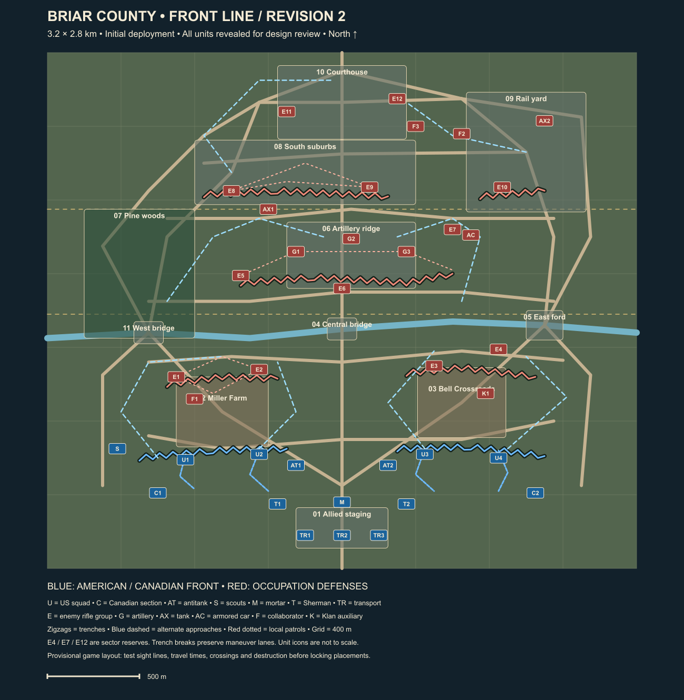

# RTS: American Front

Unreal Engine 5 alternate-history WWII RTS. First mission: fictional inland Georgia, autumn 1948, approximately 30 minutes.

**Start with [CLAUDE.md](CLAUDE.md)** for the agreed requirements and agent instructions, then read the [design specification](Design/PHASE_1_BRIAR_COUNTY.md) and [PC handoff](Design/PC_HANDOFF_PROMPT.md).

## Current map

Revision 2 is 3.2 × 2.8 km with multiple approaches to each combat objective, three vehicle crossings, and an occupied American trench line. This is a planning package; no playable Unreal project exists yet.



[Full package index](Design/README.md) · [Map data](Design/map-layout.json) · [Environment references](Design/References/environment-board.png) · [Faction references](Design/References/faction-board.png)

## On the PC

Clone this repository with GitHub Desktop, or run:

```sh
git clone https://github.com/Norcalusaf/rts-americanfront.git
```

Open the cloned folder in your coding assistant and tell it to read `CLAUDE.md` and `Design/PC_HANDOFF_PROMPT.md`. The first step is local hardware, Unreal project and owned-asset discovery.
